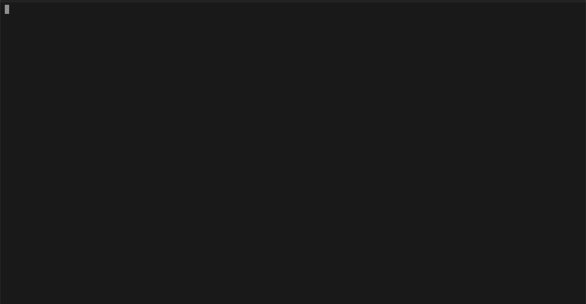
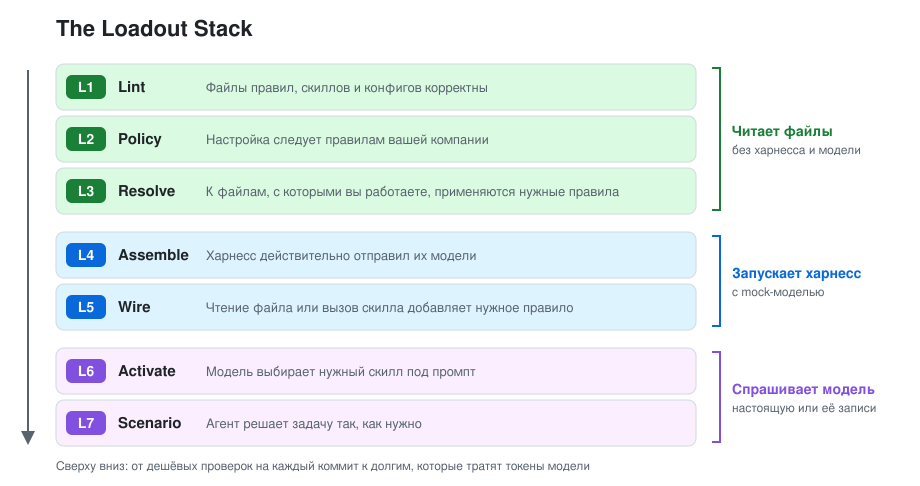
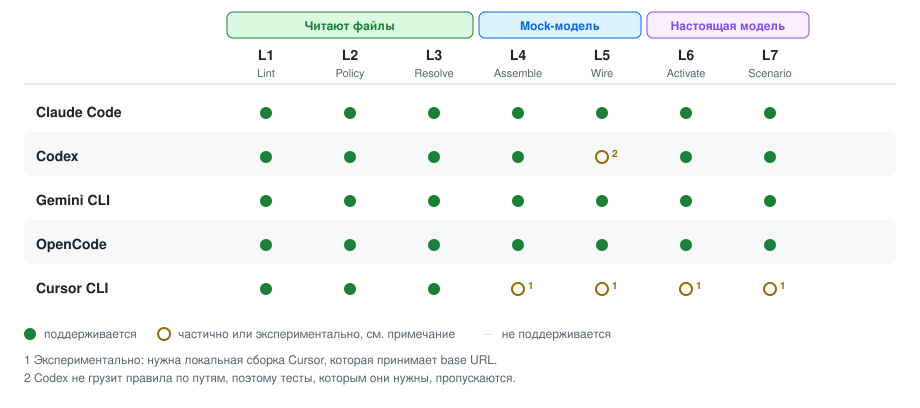

# ctxray

<p align="center">
  <a href="https://github.com/MairwunNx/ctxray/actions/workflows/ci.yml"></a>
  <a href="https://www.npmjs.com/package/@mairwunnx/ctxray"></a>
  <a href="https://github.com/MairwunNx/ctxray/releases/latest"></a>
  
  
  
  
  <a href="https://github.com/MairwunNx/ctxray/blob/master/LICENSE"></a>
  <br>
  
  
  
  
  
</p>

🩻 **ctxray** — рентген для ИИ-харнессов. Он показывает, что Claude Code, Codex, Cursor, Gemini CLI или OpenCode загрузили в модель: правила, скиллы, MCP-инструменты, системный промпт и сколько токенов стоит каждый кусок. А потом проверяет это в CI, чтобы сломанное правило не дошло до команды.

[English version](https://github.com/MairwunNx/ctxray/blob/master/README.md)

<p align="center"></p>

> [!NOTE]
> До версии 1.0 минорная версия может поменять конфиг и API тестов. Каждое такое изменение описано в [CHANGELOG.md](https://github.com/MairwunNx/ctxray/blob/master/CHANGELOG.md).

## Что вы получаете

- 🔍 **Видно, что загрузилось.** `ctxray inspect` показывает правила, скиллы, MCP-серверы с их инструментами, команды и системный промпт, с которыми ИИ-харнесс работает в этом репозитории.
- 🪙 **Токены за каждый кусок.** У каждого правила, скилла и MCP-сервера свой счёт токенов, и сразу видно, что занимает контекст. Оценки помечены ≈, а точные числа — когда их считает провайдер модели.
- ❓ **Почему оно там.** У каждого куска есть причина: включён всегда, совпал путь к файлу или его запросила модель.
- ✅ **Тесты на настройку агента.** Файлы `*.ctxray.ts` пишутся как тесты Bun или Vitest: «правила платежей грузятся для кода платежей», «контекст меньше 25k токенов», «этот промпт выбирает скилл возвратов».
- 🧪 **Один тест на все харнессы.** Тот же тест прогоняется на каждом ИИ-харнессе, которым вы пользуетесь. Копировать его под каждый не нужно.
- 🎯 **Выбирает ли модель нужный скилл?** Промпт идёт к настоящей модели несколько десятков раз, и ctxray показывает, как часто скилл загружался, с доверительным интервалом. Запишите ответы один раз, и каждый merge request воспроизводит их бесплатно.
- 📉 **Что меняет merge request.** `ctxray diff` сравнивает с основной веткой: новый MCP-сервер на 14 инструментов, правило, которое выросло на 6k токенов.
- 🧩 **Прямо в Claude Code.** `/ctxray` из плагина показывает, что загрузила текущая сессия, `/ctxray-test` запускает тесты, а Claude сам проверяет свою правку на раздутый контекст через MCP-сервер ctxray.
- 📋 **Правила вашей компании.** Лимиты токенов, запрещённые MCP-серверы, обязательный AGENTS.md проверяются на каждом merge request без обращения к модели.
- 🏢 **Работает в закрытом контуре.** Корпоративные LLM-шлюзы, прокси, свои CA-сертификаты и внутренние npm-реестры поддерживаются.
- 🔒 **Секреты не утекут.** API-ключи, токены, email, номера телефонов и карт скрываются до того, как что-то попадёт на диск.
- 📊 **Отчёты для людей и для CI.** Живой вывод в терминале, HTML-отчёт, JUnit, Allure, JSON и короткая сводка в Markdown для merge request.
- 🌍 **Русский и английский.** ctxray берёт язык системы или тот, что вы передали в `--lang`.

## The Loadout Stack

ctxray проверяет настройку агента в семь слоёв, от дешёвых к дорогим. Первые три только читают файлы и проходят на каждом коммите за миллисекунды. L4 и L5 запускают ИИ-харнесс с mock-моделью, поэтому тоже ничего не стоят. Только L6 и L7 обращаются к настоящей модели или воспроизводят её ответы, записанные один раз.

<picture>
  <source media="(prefers-color-scheme: dark)" srcset="https://raw.githubusercontent.com/MairwunNx/ctxray/master/docs/images/loadout-stack-ru-dark.svg">
  
</picture>

Страница [Loadout Stack](https://github.com/MairwunNx/ctxray/wiki/The-Loadout-Stack-RU) разбирает каждый слой на примерах.

## Поддерживаемые харнессы

ctxray читает файлы ИИ-харнесса, не запуская его. Там, где харнесс это позволяет, ctxray ещё и запускает его сам и записывает запросы к модели или записывает сессию, в которой работаете вы. Какой уровень работает для какого харнесса:

<picture>
  <source media="(prefers-color-scheme: dark)" srcset="https://raw.githubusercontent.com/MairwunNx/ctxray/master/docs/images/harness-support-ru-dark.svg">
  
</picture>

## Установка

ctxray — один исполняемый файл, больше ничего ставить не нужно. Скопируйте строку для своей системы.

macOS и Linux:

```sh
curl -fsSL https://github.com/MairwunNx/ctxray/releases/latest/download/install.sh | sh
```

Windows, в PowerShell:

```powershell
irm https://github.com/MairwunNx/ctxray/releases/latest/download/install.ps1 | iex
```

Или попробуйте в своём проекте, ничего не устанавливая:

```sh
npx @mairwunnx/ctxray inspect
```

<details>
<summary>npm, Homebrew, Scoop, Docker</summary>

Закрепите версию в проекте, чтобы у команды и в CI она была одна:

```sh
npm install --save-dev @mairwunnx/ctxray
```

Homebrew:

```sh
brew install mairwunnx/tap/ctxray
```

Scoop:

```powershell
scoop bucket add mairwunnx https://github.com/MairwunNx/scoop-bucket
scoop install mairwunnx/ctxray
```

Docker, из папки проекта:

```sh
docker run --rm -v "$PWD:/work" ghcr.io/mairwunnx/ctxray inspect
```

</details>

Зеркала, Alpine и машины без интернета описаны на странице [Getting Started](https://github.com/MairwunNx/ctxray/wiki/Getting-Started-RU). 1 ГБ памяти хватает на все слои и все харнессы, по одной сессии за раз. В [системных требованиях](https://github.com/MairwunNx/ctxray/wiki/Getting-Started-RU#системные-требования) — числа по каждому харнессу и сколько добавляют параллельные сессии.

## Быстрый старт

1. Посмотрите, что загружают ваши ИИ-харнессы в этом репозитории:

   ```sh
   npx @mairwunnx/ctxray inspect
   ```

2. Создайте конфиг и пример теста:

   ```sh
   ctxray init
   ```

   Команда пишет `ctxray.config.ts` с Claude Code и Codex и `ctxray/loadout.ctxray.ts` — тест, который проверяет, что каждый харнесс загружает свой корневой файл правил. Редактор увидит типы после `npm install -D @mairwunnx/ctxray`, но запускать тесты ctxray умеет и без этого.

3. Запустите тесты:

   ```sh
   ctxray test
   ```

   Слоям L1–L3 больше ничего не нужно. L4 запускает те ИИ-харнессы, что есть у вас в `PATH`.

4. Закрепите версии харнессов, чтобы CI запускал те же сборки, что и вы, и закоммитьте `ctxray.lock`:

   ```sh
   ctxray harness add claude-code codex
   ```

5. Запускайте тесты в CI. На GitHub:

   ```yaml
   - uses: actions/checkout@v7
   - uses: MairwunNx/ctxray-action@v0
   ```

   В GitLab подключите шаблон из релиза:

   ```yaml
   include:
     - remote: https://github.com/MairwunNx/ctxray/releases/latest/download/ctxray.gitlab-ci.yml

   ctxray:
     extends: .ctxray
   ```

6. Добавьте плагин в Claude Code:

   ```sh
   claude plugin marketplace add MairwunNx/ctxray
   claude plugin install ctxray@ctxray
   ```

   `/ctxray` показывает, что загрузила текущая сессия, а `/ctxray-test` запускает тесты.

## Документация

Руководство — в [вики](https://github.com/MairwunNx/ctxray/wiki/Home-RU):

- [Writing Tests](https://github.com/MairwunNx/ctxray/wiki/Writing-Tests-RU): API тестов, от одного правила до сотни промптов.
- [Configuration](https://github.com/MairwunNx/ctxray/wiki/Configuration-RU) и [Policies](https://github.com/MairwunNx/ctxray/wiki/Policies-RU): все настройки и правила вашей компании.
- [Harnesses](https://github.com/MairwunNx/ctxray/wiki/Harnesses-RU): какие файлы читает каждый ИИ-харнесс и как ctxray это узнаёт.
- [CI Integration](https://github.com/MairwunNx/ctxray/wiki/CI-Integration-RU) и [Enterprise](https://github.com/MairwunNx/ctxray/wiki/Enterprise-RU): GitHub, GitLab, шлюзы, прокси и закрытые контуры.

## Связанные проекты

- **[Feature-Action Architecture](https://github.com/MairwunNx/Feature-Action-Architecture)** — архитектура, по которой написан код ctxray.
- **[Allay AI](https://allay.chat)** — ИИ-помощник для серверов Minecraft, который отвечает игрокам по их настоящей игре.

## Раскрытие контента

- 🤖 **Код от ИИ.** Большую часть кода написали ИИ-агенты.
- 📡 **Телеметрии нет.** ctxray никуда не отправляет данные о вас. Он обращается только к провайдеру модели или шлюзу, который вы настроили, и только в тестах, которые запускают ИИ-харнесс.
- Бесплатно, по лицензии MIT.

> 🫡 Сделал Павел Ерохин (Pavel Erokhin), он же mairwunnx.
