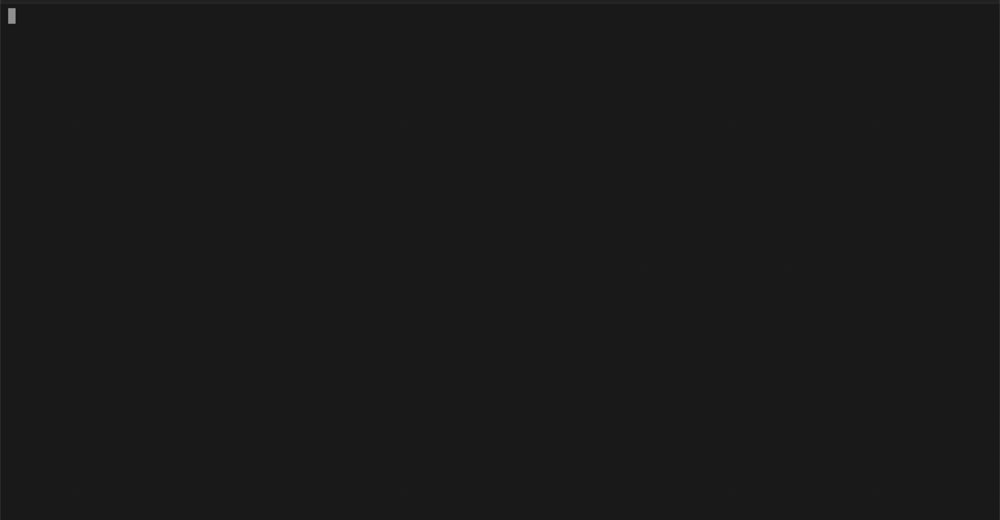
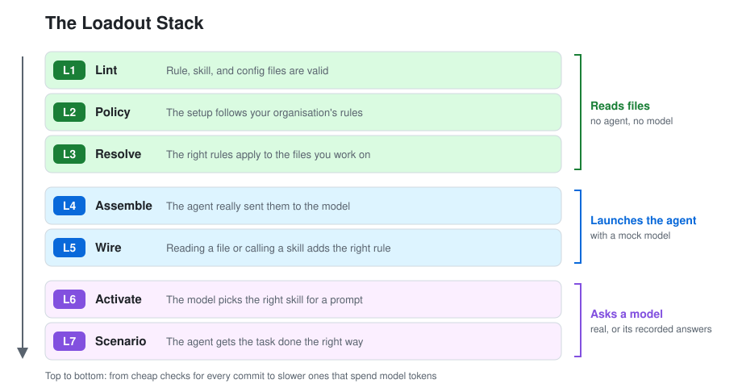
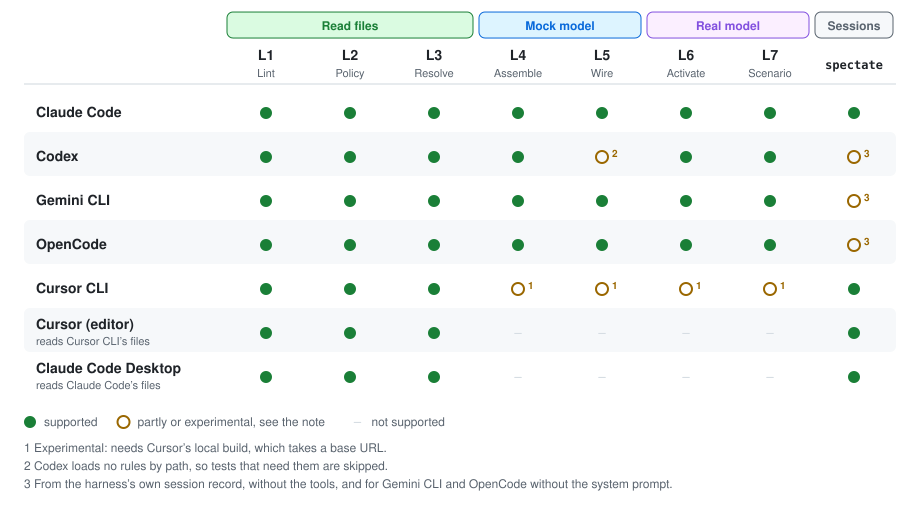

# ctxray

<p align="center">
  <a href="https://github.com/MairwunNx/ctxray/actions/workflows/ci.yml"></a>
  <a href="https://www.npmjs.com/package/@mairwunnx/ctxray"></a>
  <a href="https://github.com/MairwunNx/ctxray/releases/latest"></a>
  
  
  
  
  <a href="https://github.com/MairwunNx/ctxray/blob/master/LICENSE"></a>
  <br>
  
  
  
  
  
</p>

🩻 **ctxray** is an X-ray for agent harnesses. It shows what Claude Code, Codex, Cursor, Gemini CLI, or OpenCode loaded into the model: rules, skills, MCP tools, the system prompt, and the tokens each one costs. Then it checks that in CI, so a broken rule never reaches your team.

[Русская версия](https://github.com/MairwunNx/ctxray/blob/master/README.RU.md)

<p align="center"></p>

> [!NOTE]
> Until 1.0, a minor version may change the config and the test API. [CHANGELOG.md](https://github.com/MairwunNx/ctxray/blob/master/CHANGELOG.md) names every such change.

## What you get

- 🔍 **See what the agent loaded.** `ctxray inspect` lists the rules, skills, MCP servers and their tools, commands, and the system prompt your agent works with in this repository.
- 🪙 **Tokens for every piece.** Each rule, skill, and MCP server shows its token count, so you know what fills the context. Estimates are marked ≈, and counts are exact when the model provider counts them.
- ❓ **Why it's there.** Every piece says why it loaded: it's always on, a file path matched, or the model asked for it.
- ✅ **Tests for your agent setup.** `*.ctxray.ts` files read like Bun or Vitest tests: “payment rules load for payment code”, “the context stays under 25k tokens”, “this prompt picks the refunds skill”.
- 🧪 **One test, every agent.** The same test runs against each agent you use. You don't copy it per tool.
- 🎯 **Does the model pick the right skill?** A prompt runs a few dozen times against a real model, and ctxray reports how often the skill loaded, with a confidence interval. Record the answers once, and every merge request replays them for free.
- 📉 **What a merge request changes.** `ctxray diff` compares with the main branch: a new MCP server with 14 tools, a rule that grew by 6k tokens.
- 🧩 **Right inside Claude Code.** The plugin's `/ctxray` shows what the current session loaded, `/ctxray-test` runs the tests, and Claude checks its own change for context bloat through ctxray's MCP server.
- 📋 **Your organisation's rules.** Token limits, banned MCP servers, a required AGENTS.md: checked on every merge request, without calling a model.
- 🏢 **Works in a closed network.** Corporate LLM gateways, proxies, your own CA certificates, and internal npm registries all work.
- 🔒 **Secrets stay out.** API keys, tokens, emails, phone and card numbers are hidden before anything is written to disk.
- 📊 **Reports for people and for CI.** A live view in the terminal, an HTML report, JUnit, Allure, JSON, and a short Markdown summary for the merge request.
- 🌍 **English and Russian.** ctxray picks your system's language, or the one you pass with `--lang`.

## The Loadout Stack

ctxray checks your agent setup in seven layers, from cheap to expensive. The first three only read files and run on every commit in milliseconds. L4 and L5 launch the agent against a mock model, so they cost nothing either. Only L6 and L7 ask a real model, or replay its answers you recorded once.

<picture>
  <source media="(prefers-color-scheme: dark)" srcset="https://raw.githubusercontent.com/MairwunNx/ctxray/master/docs/images/loadout-stack-dark.svg">
  
</picture>

The [Loadout Stack](https://github.com/MairwunNx/ctxray/wiki/The-Loadout-Stack) page explains each layer with examples.

## Supported agents

ctxray reads each agent's files without launching it. Where the agent allows it, ctxray also launches the agent and records its requests to the model, or records a session you run yourself. Here's which layer works for which agent:

<picture>
  <source media="(prefers-color-scheme: dark)" srcset="https://raw.githubusercontent.com/MairwunNx/ctxray/master/docs/images/harness-support-dark.svg">
  
</picture>

## Install

ctxray is one executable with no runtime to install. Pick the channel you already use:

| Where | Command |
|---|---|
| npm | `npm install -g @mairwunnx/ctxray`, or run it once with `npx @mairwunnx/ctxray` or `bunx @mairwunnx/ctxray` |
| Homebrew | `brew install mairwunnx/tap/ctxray` |
| Scoop | `scoop bucket add mairwunnx https://github.com/MairwunNx/scoop-bucket` and then `scoop install mairwunnx/ctxray` |
| macOS and Linux | `curl -fsSL https://github.com/MairwunNx/ctxray/releases/latest/download/install.sh \| sh` |
| Windows | `irm https://github.com/MairwunNx/ctxray/releases/latest/download/install.ps1 \| iex` |
| Docker | `docker run --rm -v "$PWD:/work" ghcr.io/mairwunnx/ctxray inspect` |

[Getting Started](https://github.com/MairwunNx/ctxray/wiki/Getting-Started) covers mirrors, Alpine, and offline machines.

## Get started

1. See what your agents load in this repository:

   ```sh
   npx @mairwunnx/ctxray inspect
   ```

2. Create a config and an example test:

   ```sh
   ctxray init
   ```

   It writes `ctxray.config.ts` with Claude Code and Codex, and `ctxray/loadout.ctxray.ts`, a test that checks each one loads its root rules file. Your editor gets the types after `npm install -D @mairwunnx/ctxray`, but ctxray runs the tests without it.

3. Run the tests:

   ```sh
   ctxray test
   ```

   Layers L1–L3 need nothing else. L4 launches the agents you have on your `PATH`.

4. Pin the agents' versions, so CI runs the same builds as you, and commit `ctxray.lock`:

   ```sh
   ctxray harness add claude-code codex
   ```

5. Run the tests in CI. On GitHub:

   ```yaml
   - uses: actions/checkout@v7
   - uses: MairwunNx/ctxray-action@v0
   ```

   On GitLab, include the template from the release:

   ```yaml
   include:
     - remote: https://github.com/MairwunNx/ctxray/releases/latest/download/ctxray.gitlab-ci.yml

   ctxray:
     extends: .ctxray
   ```

6. Add the plugin to Claude Code:

   ```sh
   claude plugin marketplace add MairwunNx/ctxray
   claude plugin install ctxray@ctxray
   ```

   `/ctxray` shows what your current session loaded, and `/ctxray-test` runs the tests.

## Documentation

The [wiki](https://github.com/MairwunNx/ctxray/wiki) holds the manual:

- [Writing Tests](https://github.com/MairwunNx/ctxray/wiki/Writing-Tests): the test API, from one rule to a hundred prompts.
- [Configuration](https://github.com/MairwunNx/ctxray/wiki/Configuration) and [Policies](https://github.com/MairwunNx/ctxray/wiki/Policies): every setting, and your organisation's rules.
- [Harnesses](https://github.com/MairwunNx/ctxray/wiki/Harnesses): which files each agent reads, and how ctxray finds out.
- [CI Integration](https://github.com/MairwunNx/ctxray/wiki/CI-Integration) and [Enterprise](https://github.com/MairwunNx/ctxray/wiki/Enterprise): GitHub, GitLab, gateways, proxies, and closed networks.

## Related projects

- **[Feature-Action Architecture](https://github.com/MairwunNx/Feature-Action-Architecture)** – the architecture ctxray's code follows.
- **[Allay AI](https://allay.chat)** – an AI helper for Minecraft servers that answers players from their real game.

## Content disclosures

- 🤖 **AI-generated code.** AI agents wrote much of the code.
- 📡 **No telemetry.** ctxray sends nothing about you anywhere. It talks only to the model provider or gateway you set up, and only in tests that launch an agent.
- Free under the MIT license.

> 🫡 Made by Pavel Erokhin (Павел Ерохин), aka mairwunnx.
